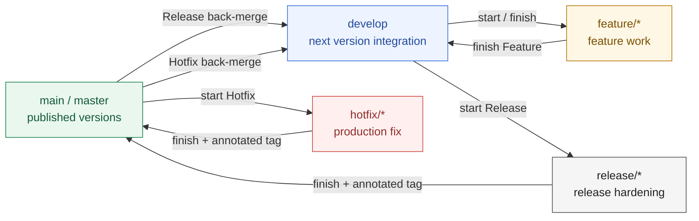
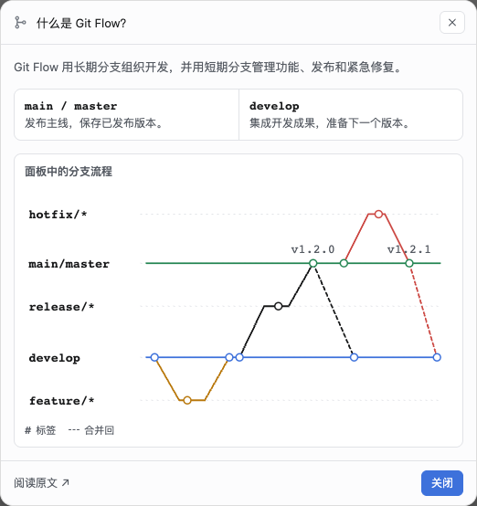
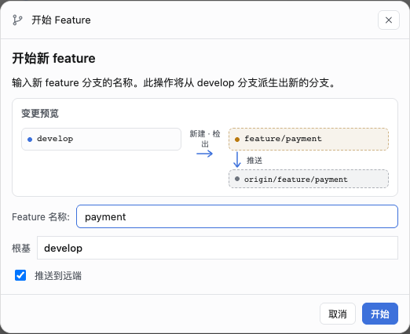
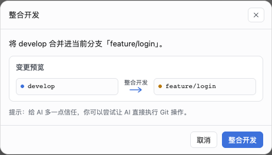
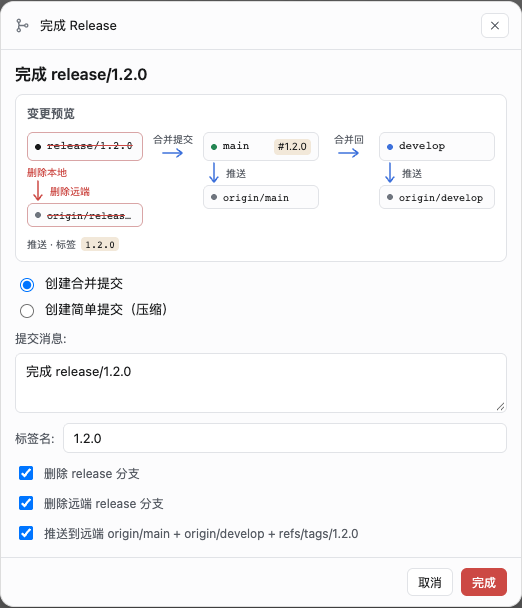
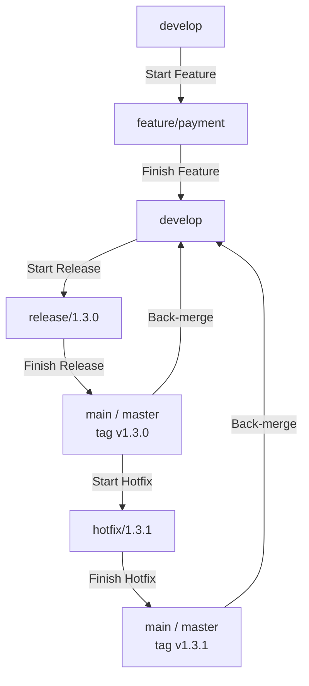

# Git Flow User Guide

Git Flow is a branching model that organizes versioned development around long-lived and short-lived branches. It fits projects with explicit releases, a release-hardening phase, or a need to maintain a published version while the next version is being developed. Git does not enforce one branching model, so the team should agree on its main-line names, release policy and branch-cleanup rules before adopting Git Flow.

Git Flow is available from the branch list in the Git Overview. It is intended for repositories that use `develop`, `main` or `master`, `feature/*`, `release/*`, and `hotfix/*` by convention.

When the host does not declare `capabilities.flow`, the panel hides the Git Flow entries. Normal branch operations remain available.

## Core concepts

- `main` / `master` is the long-lived production or published-version line. Release and Hotfix finishes create an annotated tag on it.
- `develop` integrates work for the next version. Features finish into it, and Release or Hotfix finishes merge the main-line result back into it.
- `feature/*` holds one feature or a closely related set of changes. It normally starts from `develop` and finishes back into `develop`.
- `release/*` prepares a version after feature work is frozen. It starts from `develop`, finishes into the main line with a tag, and then merges back into `develop`.
- `hotfix/*` repairs a published version. It starts from the main line, finishes there with a tag, and then merges back into `develop`.
- A tag is the stable identifier for a published version. The panel creates annotated tags for Release and Hotfix, and pushes the tag when push is selected.



In classic Git Flow, a Hotfix may also need to be synchronized into an in-progress Release branch. The panel's current automated finish path uses the main line → `develop` back-merge path. Special release coordination still needs to be handled manually.

## Screenshots from the rendered plugin

The screenshots below were captured from the built client bundle rendered in Chrome. They show the About, Start Feature, Integrate develop and Finish Release interfaces. The repository data comes from an isolated test repository and does not represent a real project's history.









## Example: from feature work to a release

Suppose the team is preparing `v1.3.0` while production needs an urgent `v1.3.1` fix. A typical sequence is:

1. Start `feature/payment` from `develop` and implement the payment work.
2. Integrate the latest `develop` into the feature branch to find conflicts early.
3. Finish the Feature into `develop`, optionally enabling chained creation of `release/1.3.0`.
4. Keep the Release branch focused on release hardening and release blockers.
5. Finish the Release. The panel integrates it into the main line, creates the annotated `v1.3.0` tag and merges the main-line result back into `develop`.
6. If production needs a fix, start `hotfix/1.3.1` from the main line. Finish it to create `v1.3.1` and merge the fix back into `develop`.



Both the Release and Hotfix create a tag on the main line. When push is selected, the panel also pushes the long-lived branches moved by the operation and the new tag. Finish is a multi-step write, so review the preview and confirmation before submitting.

## Start a flow branch

### Start a feature

1. Open the menu on the `develop` branch row.
2. Choose **Start Feature**.
3. Enter a name. The panel creates `feature/<name>`.
4. Choose whether to publish the branch.
5. Review the preview and submit.

When the repository has no local `develop`, the first feature start can create it from the selected base branch.

### Start a release

1. Open the menu on the `develop` row.
2. Choose **Start Release**.
3. Enter a version or release name. The panel creates `release/<name>`.
4. Confirm the base branch and publish choice.

A release branch is intended for release hardening and release-only fixes after feature work has been frozen.

### Start a hotfix

1. Open the menu on the `main` or `master` row.
2. Choose **Start Hotfix**.
3. Enter a version or fix name. The panel creates `hotfix/<name>`.
4. Confirm the base branch and publish choice.

A hotfix starts from the production line and is merged into both the production line and `develop` when finished.

## Integrate develop into a feature

On a `feature/*` branch, open the `develop` row menu and choose **Integrate develop**. The panel merges develop into the current feature branch.

When a conflict occurs, the panel tries to abort the merge and restore the previous state. The panel does not provide a conflict editor. Resolve conflicts in a terminal or another Git client.

## Finish a feature

1. Open the menu on the `feature/*` row.
2. Choose **Finish Feature**.
3. Choose merge, squash, or rebase.
4. Confirm that the target is `develop`.
5. Choose whether to delete the local branch and its remote upstream.
6. Choose whether to push `develop`.
7. Optionally enable chained creation of the next release.
8. Click **Finish**, then review the step confirmation.

After a squash, the flow branch is outside the target branch's ancestry. Deleting the local branch therefore needs the additional force-delete acknowledgement.

## Finish a release or hotfix

A release or hotfix finish follows these steps:

1. Integrate the flow branch into the main line.
2. Create an annotated tag on the integrated main-line commit.
3. Merge the main-line result back into `develop`.
4. Push the long-lived branches when selected.
5. Delete the remote and local flow branches when selected.

The tag identifies the release or hotfix. Finish push includes the new annotated tag and every long-lived branch moved by the operation. Remote deletion uses the expected OID with a lease, so a remote branch that advanced is preserved and the finish is refused.

## Confirmation

Finish is a multi-step write operation. The confirmation lists:

- The strategy and target branch.
- The tag.
- The back-merge into develop.
- Branch push.
- Local branch deletion.
- Remote branch deletion.
- Chained release creation.

Remote branch deletion requires an additional acknowledgement in the confirmation dialog.

## Failure states

- A dirty worktree blocks finish. Commit or stash first.
- `merge-conflict` means the first integration conflicted and the panel restored the starting state.
- `merge-stuck` means automatic recovery failed. Stop retrying and inspect whether Git is still in a merge or rebase state.
- `flow-partial` means the long-lived target branch already moved and a later step failed. Refresh and inspect branches, tags, and remote refs.
- An uncertain network result does not prove that the remote stayed unchanged. Inspect the remote before retrying.

There is no separate finish-resume dialog. When a Release or Hotfix already has its mainline merge, tag and develop back-merge, repeating the same finish request lets the host recognize the completed state and continue. For other partial results, preserve the state and inspect it first:

```bash
git status
git branch -vv
git log --oneline --decorate --graph --all
git tag --list
```

## Safe usage

- Refresh the panel before finishing a flow in a shared repository.
- Confirm the complete remote and branch names before deleting a remote branch.
- Do not force-delete a remote branch that may have been advanced by another contributor.
- Check that the release or hotfix tag exists on the remote after finishing.
- When push is rejected, inspect whether the remote is ahead or diverged. Do not use force push.

## Current scope

- Feature, Release, and Hotfix are supported.
- There are no dedicated entries for `bugfix/*` or `support/*`.
- The feature does not depend on the `git flow` CLI.
- The panel has no conflict-resolution editor.
- Force push is not available.
- The behavior follows branch-name conventions and does not automatically read `gitflow.*` configuration.
