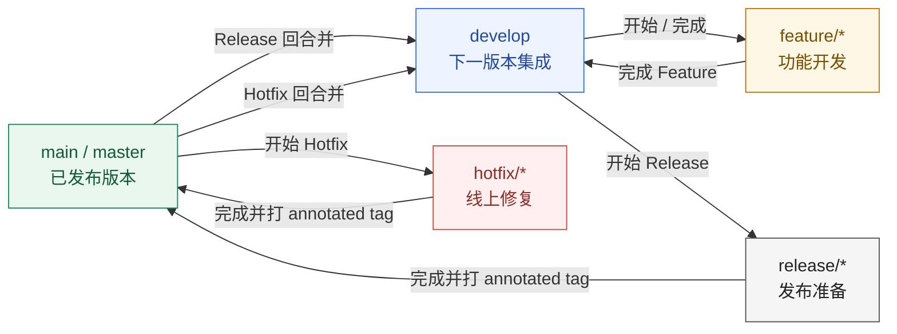
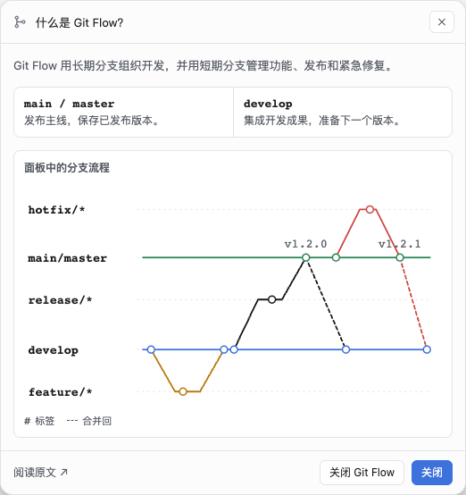
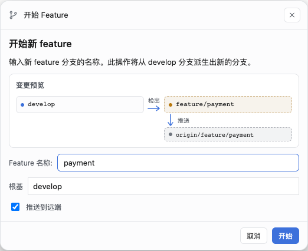
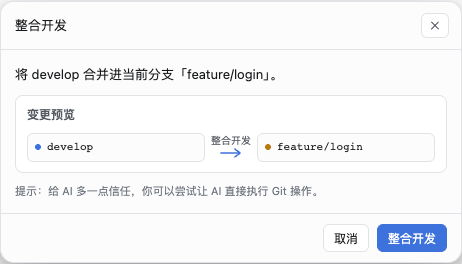
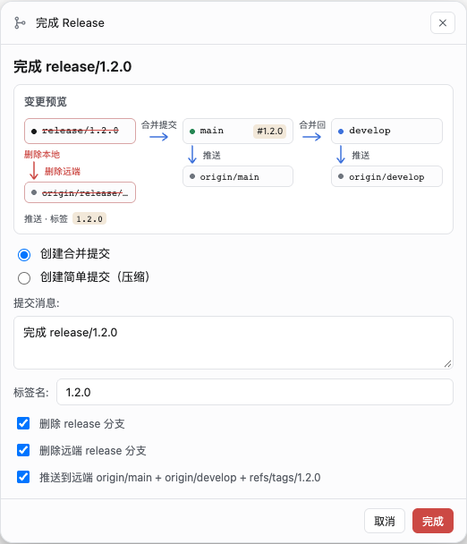
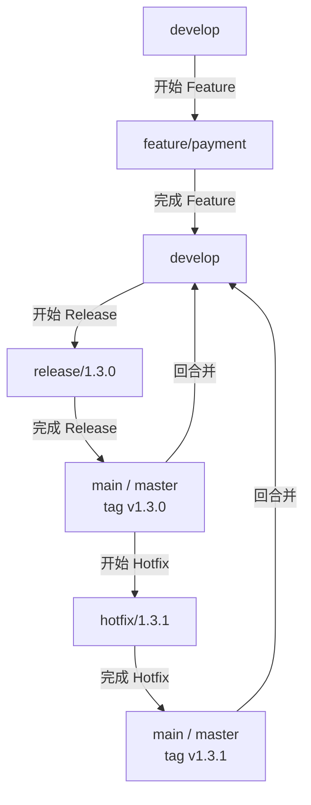

# Git Flow 使用帮助

Git Flow 是一种以长期分支和短期分支组织版本开发的分支模型。它最适合有明确版本、需要发布准备阶段，或需要同时维护已发布版本与下一版本的项目。Git 本身没有强制的分支模型，团队应先约定主线名称、发布策略和分支清理规则，再使用 Git Flow。

Git Flow 入口位于 Git 总览的分支列表中。它适合已经约定使用 `develop`、`main` / `master`、`feature/*`、`release/*` 和 `hotfix/*` 的仓库。

如果当前 host 没有声明 `capabilities.flow`，面板不会显示 GitFlow 入口。普通分支操作仍然可以继续使用。

## 基本概念

- `main` / `master` 是生产或已发布版本所在的长期分支。Release 和 Hotfix 完成后会在这条线上创建 annotated tag。
- `develop` 是下一版本的集成分支。Feature 完成后合并到这里，Release 或 Hotfix 完成后也会把主线结果合回这里。
- `feature/*` 用于一个功能或一组紧密相关的改动，通常从 `develop` 创建，完成后回到 `develop`。
- `release/*` 用于冻结功能后的发布准备。它从 `develop` 创建，完成后进入主线并打标签，再回合并 `develop`。
- `hotfix/*` 用于修复已发布版本。它从主线创建，完成后进入主线并打标签，再回合并 `develop`。
- Tag 是发布版本的稳定标识。当前面板为 Release 和 Hotfix 创建 annotated tag，并在选择推送时一并推送 tag。



经典 Git Flow 在存在进行中的 Release 时，Hotfix 也可能需要同步到该 Release 分支。本插件当前的自动完成流程固定使用“主线 → `develop`”的回合并路径，特殊发布协调仍需手动处理。

## 实机界面

以下截图来自已构建的插件 client bundle 在 Chrome 中的实际渲染，展示了介绍图、开始 Feature、整合开发和完成 Release 四个界面。截图中的仓库数据是隔离测试仓库，不代表某个真实项目的提交历史。









## 案例：从功能开发到版本发布

假设团队准备发布 `v1.3.0`，同时线上需要一个 `v1.3.1` 紧急修复。推荐的操作顺序如下：

1. 从 `develop` 开始 `feature/payment`，完成支付功能开发。
2. 在功能分支上整合最新 `develop`，提前发现冲突。
3. 完成 Feature，将它合并回 `develop`，必要时开启链式创建 `release/1.3.0`。
4. 在 Release 分支上只处理发布准备和发布阻塞问题。
5. 完成 Release，面板会把它合入主线、创建 `v1.3.0` annotated tag，再把主线结果合回 `develop`。
6. 线上发现问题时，从主线开始 `hotfix/1.3.1`。完成 Hotfix 后，面板会创建 `v1.3.1` 并把修复合回 `develop`。



这个案例中，Release 和 Hotfix 都会产生主线上的 tag。推送选项打开时，面板还会推送被移动的长期分支和新建 tag。完成操作是多步写入，提交前必须检查预览和确认框。

## 开始分支

### 开始 Feature

1. 在 `develop` 分支行打开菜单。
2. 选择“开始 Feature”。
3. 输入名称，面板会生成 `feature/<name>`。
4. 选择是否发布到 remote。
5. 查看预览并提交。

首次使用时，如果本地没有 `develop`，面板可以从所选基础分支创建 `develop`，再创建 Feature。

### 开始 Release

1. 在 `develop` 分支行打开菜单。
2. 选择“开始 Release”。
3. 输入版本或其他 release 名称，面板会生成 `release/<name>`。
4. 确认基础分支和是否发布。

Release 分支用于冻结功能、修复发布前问题和准备版本，不应继续加入未计划的功能。

### 开始 Hotfix

1. 在主线 `main` 或 `master` 行打开菜单。
2. 选择“开始 Hotfix”。
3. 输入版本或修复名称，面板会生成 `hotfix/<name>`。
4. 确认基础分支和是否发布。

Hotfix 应从当前生产主线开始，完成后会同时进入主线和 develop。

## 整合开发分支

在 `feature/*` 分支上打开 `develop` 行菜单，选择“整合开发”。面板会把 develop 合入当前 Feature。

发生冲突时，面板会尝试自动中止 merge 并恢复操作前状态。面板不提供冲突编辑器，需要解决冲突时请使用终端或其他 Git 工具。

## 完成 Feature

1. 在 `feature/*` 行打开菜单。
2. 选择“完成 Feature”。
3. 选择 merge、squash 或 rebase。
4. 确认目标为 `develop`。
5. 选择本地 branch、远端 upstream 是否删除。
6. 选择是否推送 develop。
7. 可选地勾选链式创建下一个 release。
8. 点击“完成”后，再检查步骤确认框。

Squash 后 branch 不在 develop 的祖先链上。如果要删除本地 branch，需要额外勾选强制删除。

## 完成 Release 或 Hotfix

完成 Release 或 Hotfix 时，面板会执行以下逻辑：

1. 将 flow branch 集成到主线。
2. 在主线集成提交上创建 annotated tag。
3. 将主线结果合回 develop。
4. 根据选择推送长期 branch。
5. 根据选择删除远端和本地 flow branch。

Release / Hotfix 的 tag 是发布识别的一部分。finish push 会同时推送本次移动的长期 branch 和新建的 annotated tag。远端删除使用 expected OID 与 lease 保护，远端 branch 发生推进时会拒绝删除。

## 完成确认

finish 是多步写操作。确认框会列出：

- 集成方式和目标 branch。
- tag。
- 回合并 develop。
- 推送 branch。
- 删除本地 branch。
- 删除远端 branch。
- 链式 release。

删除远端 branch 时，需要在确认框中再次勾选不可逆操作确认。

## 失败状态

- 工作区不干净时，finish 会被拒绝。请先提交或 stash。
- `merge-conflict` 表示第一次集成冲突，且面板已完成自动恢复。
- `merge-stuck` 表示自动恢复失败。停止重复点击，先检查仓库是否仍处于 merge 或 rebase 状态。
- `flow-partial` 表示长期 branch 已经移动，后续步骤失败。先刷新并检查 branch、tag 和 remote。
- 网络请求返回不确定时，不能假设远端没有变化。先检查远端 branch，再决定是否重试。

当前版本没有独立的 finish 续作界面。Release / Hotfix 的主线合并、tag 和 develop 回合并已经完成时，重复相同 finish 请求可以由 host 识别并继续后续步骤。其他 partial 状态仍建议先保留现场并检查：

```bash
git status
git branch -vv
git log --oneline --decorate --graph --all
git tag --list
```

## 安全使用建议

- 在共享仓库中完成 finish 前先刷新面板。
- 需要删除远端 branch 时确认 remote 和 branch 的完整名称。
- 远端 branch 可能已经被其他协作者推进时，不要继续强制删除。
- release / hotfix 完成后检查远端 tag 是否存在。
- 远端 push 被拒绝时，先检查远端领先或分叉状态，不要使用 force push。

## 关闭和重新开启入口

Git Flow 入口默认开启。如果不使用这套分支模型，可以在「什么是 Git Flow」弹窗底部点击「关闭 Git Flow」，二次确认后 Git 总览不再显示 Git Flow 按钮；分支、提交、文件和其它操作都不受影响。

重新开启在插件设置页完成：打开插件详情页，把「显示 Git Flow 入口」打开即可。关闭期间也可以直接在对话里让 AI 执行 Git Flow 操作，host 的 flow 动作并不会因为入口隐藏而失效。

## 当前支持边界

- 支持 Feature、Release、Hotfix。
- 不支持 `bugfix/*` 和 `support/*` 的专用入口。
- 不依赖 `git flow` CLI。
- 不提供冲突编辑器。
- 不提供 force push。
- 入口和行为以当前仓库的 branch convention 为基础，不自动读取 `gitflow.*` 配置。
